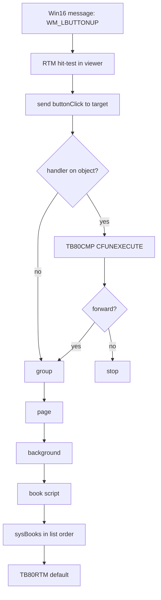

# ToolBook II 8.1 Architecture — Working Notes

> Trail, 2026-10-16. Chapters 3 and 17. If this sheet and `TBdecompile/record/` disagree, the record wins.

**Date:** 2026-10-11  
**Scope:** Native (non-DHTML) path used by the Nida ATT Master_3 course books. Build 8.10.131.

These notes synthesize the reverse-engineering work (SoftICE on Win98, Optloader unpack, Ghidra, book carving) with the published ToolBook object model. They are meant to sit alongside the raw materials in this folder.

## 1. What the runtime actually is

ToolBook is a 16-bit book engine with a thin 32-bit launcher. The Navy lessons never execute OpenScript themselves. `tbload.exe` hands the `.tbk` to the engine; the engine walks a containment hierarchy until a handler says `go`.

```
tbload.exe (PE)
    → MINSTB32 / TB80RUN.EXE          32-bit process, mutexes
         → TB80W32.DLL                flat thunks, MEM1632, TBXInstance
              → NTVDM
                   → TB80W16.DLL      CallProc32W, file, palette, graphic thunks
                        → TB80RTM.EXE main window, dialogs, status bar
                             → TB80BAS.DLL   CDB* book server (606 exports)
                                  → TB80CMP.DLL   compile / execute OpenScript
```

- `TB80RTM.EXE` is an SLR Optloader image. Unpacked NE is in the project artifacts.
- Internal window class names in the runtime are `EGYPT*`. The media engine calls itself Lionel (`LIONELNOTIFYPROC`).
- The book engine only stays stable enough to single-step on Win98. XP NTVDM is not usable for this.
- SoftICE saw object 0 / page `P0` at linear `80556D4F`. The in-memory property block was `14 00 00 11`, not the on-disk `14 00 00 01`.

Startup also reads `startupSysBooks` / `SYS:STARTUPSYSBOOK=`. This install’s `toolbook.lst` pulls the NIDA system books before the stock runtime books.

## 2. Book shell vs. classic book

These course books are Click2learn shells, not classic `03 4A 42 4F` files at offset 0.

| Offset | Content |
|--------|---------|
| 0x0000 | PE stub, 0xC00 bytes, no useful code |
| 0x0C00 | `ZZZTBKBOOKLOC` + magic `0x22222222` |
| 0x0C00+ | Book stream: `03 4A 42 4F` + version `01 00 00 08` |

Opener is `tbload.exe` via `MINSTB32.dll`.

## 3. Object model

A book is the document. A page is one screen. A background is the shared layer behind many pages. A viewer is a window onto a page. Everything else is a child of a page or a background.

```
system books (tb80r.sbk, tb80hyp.sbk, tb80anm.sbk, nc81*.sbk)
    book
        background
            page
                group
                    object  (button, field, picture, paint, rectangle, …)
```

A click does not call a function pointer stored in the book. The runtime builds a message and walks up until a handler takes it. `forward` is explicit. If nobody handles it, `TB80RTM` does.



Reader vs Author is a mode bit, not a second engine. Runtime ships `tb80r.sbk` and omits the author editor. `TB80EDT.DLL` is named in the runtime strings and is absent from this tree.

## 4. On-disk records (verified on 150 course books)

| Field | Value |
|-------|-------|
| Stream signature | `03 4A 42 4F` |
| Version | `01 00 00 08` |
| Object marker | `80 65 00 05 00 02 02` (34,547 hits) |
| After marker | object id dword, then a 32-byte name |
| Name rule | leading C string; tail is stale heap |
| +43 from marker | property block `14 00 00 01`, then six words |
| In memory | same block seen as `14 00 00 11` |
| Scripts | tokenized OpenScript; high bytes are opcodes, ASCII is leftover words |
| Pictures | whole Windows BMPs, plus a few raw `BITMAPINFOHEADER`s |

`93950101.TBK` has 299 marked objects and 85 handlers, almost all `buttonClick`. Page ids (`P0`, `PINFO`, `P410`) are object names. Many `go` targets are token operands, not quoted strings.

Widget bounds and picture ids are not in the fixed header. Drawn objects and ToolBook-compressed DIBs are still opaque. The 1.5 `PHYSSIZE` index documented by dexvert does not occur in these 8.1 books.

Property IDs recovered from TB80BAS resources include bounds=0x4004, text=0x402e, script=0x4023, vertices=0x4034.

## 5. Pseudocode

### Launch and open

```text
tbload(path):
    map ZZZTBKBOOKLOC at file+0xC00
    require magic 0x22222222
    spawn TB80RUN
    TB80W32.Initialize(TBXInstance)
    thunk to TB80RTM.MainWndProc
    CDBINIT()                          # TB80BAS ordinal 1
    inst = CDBCREATEINSTANCE()
    CDBFILEOPEN(inst, bookStream)      # ordinal 8
    push sysBooks from toolbook.lst    # NC81BASE, NC81TEST, NC81RECS, NC81TRNR, then tb80r
    CDBVIEWPAGE(inst, firstPage)
    enter reader level
```

### Message walk

```text
send(target, message, args):
    for obj in chain(target, group..., page, background, book, sysBooks):
        script = obj.script
        if script is source text:
            script = COMPILERCOMPILETEXT(script)     # TB80CMP ordinal 1
        if handler(script, message):
            r = CFUNEXECUTE(handler, args)           # ordinal 8
            if not r.forwarded:
                return r
    return runtimeDefault(message)
```

### What a lesson button does

```text
to handle buttonClick
    go to page "P410"
end

# becomes, after the walker:
CDBVIEWPAGE(instance, resolve("P410"))
paint background, then page objects
TB80BMP / TB80JPG for pictures
TB80LNL if the object is a clip
```

`get`/`set` of a property does not always hit script. `TB80CMP` also exports `COMPILERPROPINFOFROMINDEX`, and `TB80BAS` exports `CDBGETSELECTPROP` / `CDBSETSELECTPROP`. Properties are a table in the server, with script handlers only as overrides.

## 6. Painting (partial)

Live object layout recovered from SoftICE + BAS painters:

- Bounds (left, top, right, bottom in twips) at object+0x0F.
- Polygon: count at +0x30, point array far pointer at +0x32.
- Twip-to-screen: `(twips * dpi + 720) / 1440` (dpi factors normally 96).

```text
function PaintPolygon(obj):
    count = word(obj + 0x30)
    pts   = farptr(obj + 0x32)
    for i in 0..count-1:
        screenPts[i] = ScaleTwipsToScreen(pts[i])
    GDI.Polygon(screenPts, count)
```

On-disk polygon records (kind `04 00` inside `14 00 00`) store the point count and twip pairs directly. Other draw objects (arc, curve, picture placement) are only partially mapped.

## 7. What is still open

Ordered by what unblocks a faithful viewer.

1. **Property block after `14 00 00 01`.** Six words are live. Bounds and parent id are not in them. The in-memory `14 00 00 11` flag is the clue: disk records are compacted, and `CDBFILEOPEN` expands them.
2. **Page and background indexes.** Object markers are a heap, not a display list. Parent, layer, and shared-background links are still missing.
3. **Picture and resource ids.** Carved BMPs are the easy case. Compressed DIBs, paint objects, and shared chrome references are not.
4. **OpenScript opcode table.** `COMPILEREXPANDTEXT` is the oracle. One handler compiled and expanded gives the token map the course books need. The current decoder works but keywords do not yet match expected OpenScript on every stream (see `openscript_notes.md`).
5. **`CDBFILEOPEN` itself.** Ordinal 8 in unpacked `TB80BAS`. The 1.5 path was “canonicalize, already-open check, storage loader.” The 8.1 loader is the same shape and has not been traced past the Optloader unpack.
6. **System-book scripts.** `tb80r.sbk` and the four `nc81*.sbk` files hold the lesson chrome. They are ordinary books and have not been fully decompiled.
7. **`TB80RCR`, `TB80RMT`, `TB80ACX`.** Named and exported, not fully annotated.
8. **Author side.** `TB80EDT.DLL` and `TB80.EXE` are absent.
9. **Packing leftovers.** Segment 182 in `TB80BAS` has a bind at `0x129` that is not one of its five relocations.

The viewers in `artifacts/viewer2` and the Maybe* lessonshells are catalogs and page frames. They are not this runtime. They will match the lessons when the property block, the page index, and the opcode table are filled in. The engine that already knows those three is `TB80BAS` ordinal 8 and `TB80CMP` ordinals 1, 3, and 8.

## 8. Sources in this folder

- `binaries/` — original NE/PE modules and system books from the runtime set.
- `decompiles/` — Ghidra `.c` exports of the unpacked modules.
- `notes/` — prior architecture chapters, OpenScript notes, record notes, viewer construction.
- `softice/` — SoftICE installer and related debugger disks.
- `gzf/` — Ghidra project fragments (vdm_low.bin.gzf).
- `system-books/` — `.sbk` files (tb80r, tb80hyp, tb80anm, nc81*).
